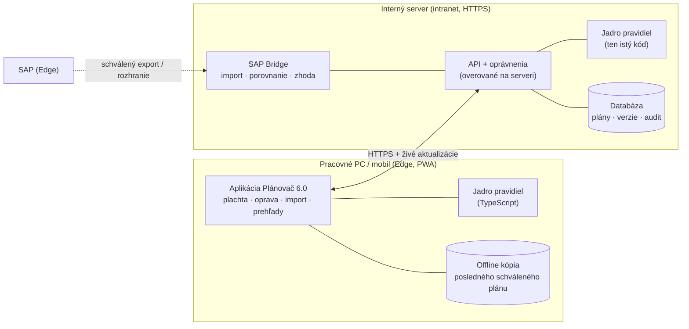
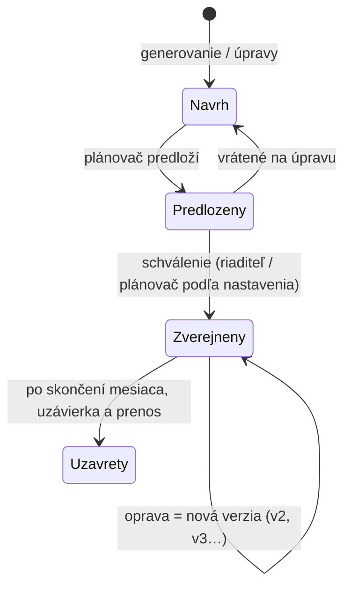

# Fáza 2 – Návrh Plánovača služieb 6.0

> **V jednej vete:** Plánovač 6.0 je interná webová aplikácia, ktorá má jedno overené jadro
> pravidiel (rovnaké ako vo verzii 5.0 v47), číta zmeny zo SAP-u namiesto toho, aby ich plánovač
> zadával druhýkrát, a pri výpadku (PN, DOV…) navrhne najmenší možný zásah do schváleného plánu –
> nikdy nepregeneruje celý mesiac.

Súvisiace dokumenty: `01-analyza-planovac-5.md` (pravidlá R1–R24, zistenia Z1–Z24),
`03-sap-integracia.md` (riešenie duplicity so SAP-om).

---

## 1. Princípy, ktoré platia v celom návrhu

1. **Zmenu zadávaš iba raz.** Každá udalosť (PN, výmena, náhrada) sa zadá na jednom mieste a
   ostatné miesta sa zosúladia automaticky. Plánovač priebežne kontroluje **zhodu so SAP-om**.
2. **Pravidlá majú posledné slovo.** Existuje jediné jadro pravidiel. Generátor, oprava, Poradca,
   ručná úprava, import aj server ho volajú rovnako – nemôže sa stať, že Poradca povolí niečo, čo
   generátor zakáže (dnes Z7, Z10, Z13).
3. **Minimálny zásah.** Schválený plán sa počas mesiaca iba opravuje. Odpracované a prebiehajúce
   služby sú nemenné, potvrdené zmeny zo SAP-u sa nemenia.
4. **Človek schvaľuje.** Systém navrhuje a vysvetľuje; zmenu oficiálneho rozpisu potvrdzuje plánovač
   (príp. riaditeľ). Nikdy sa nevytvorí neplatný plán len preto, aby boli všetky miesta obsadené.
5. **Údaje zostávajú vnútri.** Žiadne externé servery, CDN ani telemetria. Všetky knižnice sú
   zabalené v aplikácii.

---

## 2. Celková architektúra

### Jedna kódová základňa, tri spôsoby prevádzky

| Režim | Pre koho | Kde sú údaje | Kedy |
|---|---|---|---|
| **A – Prenosný súbor** (ako dnešný `index.html`) | testovanie s fiktívnymi údajmi, núdzová záloha | v prehliadači (IndexedDB), export/import súboru | ihneď, bez IT |
| **B – Lokálny server na PC plánovača** | malé pracovisko bez servera | databáza na PC, ostatní cez `https://IP-PC` v sieti | potrebné povolenie spustiť program a otvoriť port |
| **C – Interný server (odporúčaný cieľ)** | celé pracovisko, viac zariadení | databáza na serveri, denné šifrované zálohy | po schválení IT a bezpečnosti |

Technológie: **TypeScript** všade; jadro pravidiel je samostatný balík bez závislosti od UI
(beží v prehliadači, na serveri aj v testoch). UI: React/Preact + Vite (rýchle aj na starších PC),
režim A sa zostaví do jedného HTML súboru. Server: Node.js (Fastify), **SQLite** (jeden súbor,
jednoduché zálohovanie; PostgreSQL ako voľba, ak to IT vyžaduje), živé aktualizácie cez SSE.
Inštalácia: Docker image alebo služba Windows.

---

## 3. Ako zachovám všetky pôvodné pravidlá

Toto je najrizikovejšia časť projektu, preto má vlastný postup s merateľným dôkazom.

1. **Inventár pravidiel** R1–R24 (hotový, `01-analyza-planovac-5.md`) – každé pravidlo má presný
   význam a odkaz na riadok pôvodného kódu.
2. **Prenos do jadra 1:1.** Každé pravidlo = jedna pomenovaná funkcia s testami. Tri kópie
   pravidla 32 h sa zlúčia do jednej.
3. **Profil „v47-kompatibilný“** sa správa **presne** ako dnes, vrátane obmedzení (napr. okná
   32 h len v rámci mesiaca). Je to referencia a predvolený stav, kým neodsúhlasíš opravy.
4. **Rozdielové testovanie proti originálu.** Generátor syntetických scenárov (35 osôb, rôzne
   mesiace, prelomy mesiacov, zmena času, PN/DOV/CHV, prenosy, nadčasy, ručné zámky, dvojice)
   spustí ten istý scenár v **pôvodnom `index.html`** (headless Edge/Chromium – princíp už funguje
   v `docs/overenie/overenie-v47.js`) aj v novom jadre a porovná:
   zoznam problémov z Kontroly, dostupnosť kandidáta pre generátor, kontrolu Poradcu, fond,
   prenos, výsledok výmeny. **Kritérium prijatia: 100 % zhoda na ≥ 10 000 náhodných scenároch**
   + ručne písané hraničné prípady.
5. **Generátor** sa prenesie 1:1 s riadenou náhodou (seed → opakovateľný výsledok). Keďže je
   náhodný, kvalita sa porovná štatisticky na 200 mesiacoch (počet problémov, rozptyl fondu,
   rozdeľovanie stálych dvojíc, striedanie denných/nočných).
6. **Opravy chýb sú samostatné prepínače**, každý s vlastným testom a zapne sa až po tvojom súhlase:

| Oprava | Rieši | Návrh |
|---|---|---|
| O1 Oddych cez prelom mesiaca | Z1 | kontrolovať aj so službami predchádzajúceho/nasledujúceho mesiaca |
| O2 32 h cez prelom mesiaca | Z2 | okná 32 h aj cez hranicu mesiaca (rovnaký výklad, len bez prerušenia) |
| O3 Prenos uložený pri mesiaci | Z3, Z17 | `fond, prenos` osoby pre každý mesiac zvlášť; prenos sa dá zamknúť |
| O4 Individuálny fond | Z4 | generovanie neprepíše ručne nastavený fond osoby |
| O5 Nočná pred PN | Z6 | nezmizne potichu – stane sa „nepokrytou službou“ v režime opráv |
| O6 Rovnaké kontroly všade | Z7, Z10, Z13, Z14, Z18 | Poradca, oprava aj ručná úprava používajú tie isté pravidlá ako generátor |
| O7 Úplné „Vrátiť späť“ | Z8 | každá zmena je verzia; vrátiť sa dá čokoľvek |
| O8 Úplný export | Z16 | Excel/PDF vrátane nadčasov a prenesených úsekov |
| O9 Jednotný čas | Z11 | výpočty vždy v pásme Europe/Bratislava (zhodne so SAP – potvrdiť) |

Starý JSON export (vrátane starých prenosov `carryover`) sa dá **naimportovať** do 6.0 –
migrácia sa testuje na exportoch z rôznych verzií.

---

## 4. Stav plánu a služieb

- **Zverejnená verzia sa nikdy neprepisuje.** Každá oprava vytvorí novú verziu s autorom, časom a
  dôvodom; dá sa zobraziť rozdiel medzi verziami („čo sa zmenilo od zverejnenia“).
- Každá služba má stav: **plánovaná → potvrdená v SAP → prebieha → odpracovaná**. Prebiehajúce a
  odpracované služby sú zamknuté natrvalo (opravu môže urobiť len administrátor so záznamom v audite).
- Každá služba nesie **zdroj**: generátor, ručne, oprava, import SAP, výmena – aby bolo jasné, čo
  smie oprava meniť.

---

## 5. Režim inteligentnej opravy (Fáza 4)

Samostatný režim, nie generátor. Spúšťa sa udalosťou: PN/DOV/CHV, odobratie služby, posilnenie
služby, zmena obsadenia, žiadosť o výmenu – zadanou ručne alebo **zistenou z importu SAP**.

### Postup (presne podľa tvojho príkladu)

| Krok | Čo urobí systém |
|---|---|
| 1. Rozpoznanie | Import SAP ukáže novú PN Mareka 10.–20.10. (alebo ju plánovač zadá) |
| 2. Dopad | Nájde všetky Marekove služby, ktoré zasahujú do intervalu PN – **vrátane nočnej 9.10. 19-07**, ktorá končí 10.10. ráno (dnes by potichu zmizla, Z6) |
| 3. Čo už rieši SAP | Porovná s importom: ak 12.10. v SAP-e už slúži Rasťo namiesto Mareka, služba je **pokrytá** a označená „prevzaté v SAP“ – oprava ju nemení |
| 4. Ochrana | Nemení odpracované a prebiehajúce služby, potvrdené zmeny zo SAP-u, ručné zámky, ostatné schválené služby (meniť ich smie len ako výslovný a „drahý“ krok varianty) |
| 5. Nepokryté miesta | Zostanú iba skutočne nepokryté miesta od „teraz“ dopredu; tie, ktoré začínajú do 12 h, sú označené ako **urgentné** |
| 6. Hľadanie riešení | Priame pridelenie voľného človeka (riadne, ak je pod maximom fondu) → nadčas → presun s doplnením (reťaz dvoch krokov) → výmena; vždy so zohľadnením dvojíc (stály parťák Mareka ostáva na službe, hľadá sa mu vhodný partner, zakázané dvojice sú tvrdé) |
| 7. Overenie | Každá varianta prejde **celým jadrom pravidiel** (oddych, 32 h, max po sebe, fond, neprítomnosti, dvojice, obsadenie) aj cez prelom mesiaca; nesmie pribudnúť žiadny závažný problém |
| 8. Návrh | 2–3 odlišné varianty s vysvetlením, napr. *A: 4 zmeny, 1 nadčas 12 h (Kiso – najmenej nadčasov) · B: bez nadčasu, 7 zmien · C: najrovnomernejší fond* |
| 9. Schválenie a zápis | Po potvrdení vznikne nová verzia plánu, dotknutí policajti dostanú upozornenie a vznikne **zoznam zmien pre SAP** (alebo sa zapíšu cez schválené rozhranie) |

Ak náhrada neexistuje, systém to povie priamo a uvedie dôvody súhrnne, napr.:
*„15.10. 19-07 – 1 miesto nepokryté. Z 18 ľudí: 7× oddych < 12 h, 5× chýbalo by 32 h voľna,
3× PN/DOV, 3× len nadčasom, ale porušil by max. 4 služby po sebe.“* Miesto ostane nepokryté a
viditeľné na hlavnom paneli.

### Algoritmus opravy

- **Poradie hodnotenia (lexikograficky):** 1) všetky tvrdé pravidlá, 2) žiadna zmena chránených
  služieb, 3) maximálne obsadenie, 4) najmenší počet zmenených služieb, 5) najmenej nadčasových
  hodín, 6) rovnomerné zaťaženie (fond, nadčasy, noci, víkendy), 7) jednoduchosť (menej ľudí,
  zachované stále dvojice).
- **Vyhľadávanie:** vetvenie s orezávaním (branch & bound) – najprv miesta s najmenším počtom
  kandidátov; kontrola sa robí **inkrementálne** len pre dotknuté osoby a celá varianta sa na konci
  overí kompletnou kontrolou. Reťazenie je obmedzené na 2 kroky, aby návrhy boli realizovateľné
  jedným telefonátom.
- **Deterministické** – rovnaký vstup dá rovnaký návrh (dôležité pre dôveru a pre testy).
- Typická udalosť (≤ 20 miest, 35 osôb) má trvať pod sekundu priamo v prehliadači – funguje aj
  offline a v režime A.

---

## 6. Optimalizácia generovania mesiaca

| Tvrdé (nikdy neporušiť) | Mäkké (optimalizovať) |
|---|---|
| obsadenie nesmie prekročiť potrebu; rola; PN/DOV 00–24; oddych ≥ min; žiadny prekryv; 32 h voľna; max po sebe; fond max (inak len nadčas); zakázané dvojice; pomocná sila len s členom hliadky; ručné zámky, prenosy, odpracované služby | úplné obsadenie; fond blízko minima a rovnomerne v skupine; stále dvojice spolu; striedanie denných/nočných; bloky 2–3 služieb; voľné víkendy a bloky voľna; pestrosť druhej hliadky; menej nadčasov |

1. **Etapa 1:** prenesiem overený heuristický generátor (aby plány „vyzerali ako doteraz“) a pridám
   tlačidlo **„Vylepšiť“** – lokálne vyhľadávanie po vygenerovaní, ktoré zlepšuje iba mäkké kritériá
   a nikdy neporuší tvrdé.
2. **Etapa 6 (voliteľne): Google OR-Tools CP-SAT** na serveri. Prínos: vie **dokázať**, že riešenie
   bez porušenia pravidiel neexistuje (a povedať prečo), a lepšie vyvažuje férovosť. Nevýhody:
   potrebuje Python na serveri a nefunguje v offline súbore. Preto ho navrhujem ako doplnok
   s porovnávacím testom proti heuristike – nasadí sa, len ak bude merateľne lepší.
   **Každé riešenie optimalizátora overí jadro pravidiel** („optimalizátor navrhuje, jadro schvaľuje“).

---

## 7. Štyri roly a oprávnenia (overované na serveri)

| Oprávnenie | Administrátor | Plánovač | Riaditeľ | Policajt |
|---|:-:|:-:|:-:|:-:|
| Používatelia, roly, pracoviská | ✔ | – | – | – |
| Nastavenia a pravidlá (v povolenom rozsahu) | ✔ | návrh zmeny | – | – |
| Generovanie, úpravy, oprava, náhrady, nadčasy | ✔ | ✔ | – | – |
| Import a zhoda so SAP | ✔ (prehľad, mapovania) | ✔ | prehľad | – |
| Predloženie / zverejnenie plánu | ✔ | ✔ | – | – |
| Schválenie plánu a nadčasov | podľa nastavenia | podľa nastavenia | ✔ | – |
| Prezeranie schválených plánov, prehľady, štatistiky | ✔ | ✔ | ✔ | – |
| Spoločný rozpis | ✔ | ✔ | ✔ | povolená časť |
| Vlastné služby, upozornenia, žiadosť o výmenu | – | – | – | ✔ |
| Dôvod neprítomnosti (PN/DOV/CHV) | ✔ | ✔ | podľa nastavenia | iba „neprítomný“ |
| História zmien, audit, diagnostika, zálohy | ✔ | vlastné zmeny | prehľad zmien | – |

- Kontrola práv je **na serveri** pri každej požiadavke; policajtovi sa citlivé polia vôbec
  neodošlú (nie len skryjú v UI). PN je údaj o zdraví – zobrazí sa len oprávneným.
- Prihlásenie: ideálne cez Active Directory / jednotné prihlásenie (po dohode s IT); inak lokálne
  účty s bezpečným hashom hesla (Argon2id) a dvojfaktorovým overením.

---

## 8. Centrálna databáza (hlavné tabuľky)

| Tabuľka | Účel |
|---|---|
| `pracovisko`, `pouzivatel`, `rola_pouzivatela` | organizácia, účty, roly |
| `osoba` | meno, osobné číslo SAP, rola v službe, poradie, platnosť od–do |
| `osoba_mesiac` | **fond min/max a prenos pre konkrétny mesiac** (oprava Z3/Z4), zdroj prenosu, zámok |
| `sada_pravidiel` | pravidlá s platnosťou od mesiaca (staré mesiace sa kontrolujú podľa svojich pravidiel) |
| `dvojica_stala`, `dvojica_zakazana`, `zakaz_skupiny` | dvojice s platnosťou |
| `plan` | mesiac, stav, aktuálna verzia, kto schválil/zverejnil |
| `sluzba` | osoba, deň, kód, začiatok/koniec (presný čas), druh (riadna/nadčas/prenos), stav, zdroj, zámok, odkaz na SAP |
| `nepritomnost` | osoba, typ, od–do, zdroj (ručne/SAP), viditeľnosť dôvodu |
| `zmena` (changeset) | jedna logická zmena: autor, čas, dôvod, verzia plánu pred/po, položky |
| `udalost`, `navrh_opravy` | udalosť (napr. PN), varianty riešenia, zvolená varianta, schválenie |
| `sap_import`, `sap_mapovanie` | každý import (zdroj, hash súboru, výsledok), mapovanie kódov a osôb |
| `ziadost_vymena`, `upozornenie` | žiadosti policajtov, notifikácie |
| `audit` | nemenný záznam všetkých akcií (reťazené hashe na odhalenie úprav) |

Súbežná práca: optimistické zamykanie podľa verzie – ak dvaja upravia to isté, druhý dostane
prehľadné porovnanie a rozhodne; zmeny ostatných sa zobrazia okamžite (živé aktualizácie).

---

## 9. Online, offline a lokálna prevádzka

**Odporúčanie:** interný server (režim C) dostupný v intranete cez HTTPS s interným certifikátom;
aplikácia ako PWA nainštalovateľná v Edge na PC aj na služobnom mobile (ak má prístup do vnútornej
siete / VPN).

- **Offline pre všetkých:** posledný **schválený** plán sa uloží do zariadenia a zobrazí sa s
  výrazným pruhom *„OFFLINE – kópia zo 14.10. 14:32, nemusí byť aktuálna“*. Policajt tak vidí svoje
  služby aj bez siete, ale nikdy si nepomýli kópiu s aktuálnym stavom.
- **Offline pre plánovača:** môže pracovať na **návrhu** (napr. ďalší mesiac); po pripojení sa
  návrh odošle, server ho overí jadrom pravidiel a prípadné konflikty ukáže na rozhodnutie.
  Zverejnený plán offline meniť nemožno.
- Offline kópiu na neslužobných zariadeniach možno zakázať nastavením.
- Režim A (prenosný súbor) zostáva na testovanie s fiktívnymi údajmi. **Skutočné údaje nikdy
  nepatria na GitHub ani iný externý server** – GitHub Pages môže hostiť len kód testovacej verzie.

---

## 10. Používateľské rozhranie

- **Hlavný panel plánovača „Dnes“:** čo treba vyriešiť (napr. *„SAP: nová PN – 3 nepokryté služby
  → Vyriešiť“*), urgentné miesta (do 12 h), stav zhody so SAP, obsadenosť mesiaca, žiadosti o
  výmenu, plány na schválenie.
- **Plachta** zostáva srdcom aplikácie (všetky dnešné funkcie z inventára), ale: úprava bunky v
  malom okne priamo pri bunke namiesto veľkého modálu, ovládanie klávesnicou (šípky + písanie kódu),
  hromadný výber ťahaním, prepínač **„Zmeny od zverejnenia“**, história bunky, odznaky konfliktov.
- **Panel opravy:** udalosť → dopad → varianty vedľa seba → „Použiť variantu A“.
- **Import SAP:** pretiahnuť súbor / vložiť zo schránky → náhľad zmien so zaškrtávaním → potvrdiť.
- **Policajt (mobil):** moje najbližšie služby, kalendár, zmeny, žiadosť o výmenu (systém hneď
  overí pravidlá a ponúkne len platné výmeny).
- **Riaditeľ:** obsadenosť, nadčasy (trend, kto, prečo), otvorené problémy, história zmien.
- Tlač A3 zachovaná; skutočný **XLSX** a PDF export (úplný, vrátane nadčasov a prenosov);
  automatické zálohy namiesto ručného „Uložiť“.
- Dizajn: svetlý/tmavý režim, väčšie a čitateľnejšie bunky, jednotná farebnosť služieb ako doteraz
  (plánovači sú na ňu zvyknutí), prístupnosť (kontrast, klávesnica).

---

## 11. Nové funkcie a odhad ušetrenej práce

Predpoklady (prosím uprav podľa reality): 35 osôb, 1 plánovač, ~15 zmien počas mesiaca, ~3 PN
mesačne, plán ~650 zápisov mesačne.

| Funkcia | Dnes (odhad) | S 6.0 | Úspora / mesiac | Podmienka |
|---|---|---|---|---|
| Zmeny počas mesiaca bez dvojitého zápisu (import + zhoda SAP) | 15 × 3 min | import ~5 min | ~40 min + žiadne rozdiely | povolený export zo SAP |
| Náhrada pri PN jedným klikom | 3 × 30 min | 3 × 5 min | ~75 min | žiadna (beží offline) |
| Prenos mesačného plánu do SAP | 2–4 h | asistované zadanie ~1–2 h; nahratie/rozhranie ~10 min | 1–4 h | rozhranie / nahrávací program od IT |
| Aktuálny plán pre všetkých (bez tlače a rozposielania) | ~1 h | ~0 | ~1 h | server |
| Žiadosti o výmenu s automatickou kontrolou | 10 min / žiadosť | 2 min | podľa počtu | server |
| Uzávierka mesiaca a prenos hodín | ~20 min | ~2 min | ~18 min | – |
| Kontrola zhody so SAP (odhalenie chýb pri prepisovaní) | ručne / vôbec | automaticky | menej chýb | export zo SAP |

Ďalšie návrhy: kalendár sviatkov SR s vlastným obsadením, predpoveď fondu a prenosu do konca
mesiaca, „pieskovisko“ (skúsiť zmenu bez dopadu na plán), šablóny opakujúcich sa vzorov pre stále
dvojice, limity nadčasov (ak ich máte), kvalifikácie (vodič, psovod…) ak treba.

**Spolu odhadom 4–7 hodín mesačne** pri jednom pracovisku, a hlavne **koniec rozdielnych rozpisov**.
Odhady spresním, keď mi napíšeš skutočné časy.

---

## 12. Bezpečnosť

- HTTPS aj vo vnútornej sieti, prísna bezpečnostná politika obsahu (aplikácia nesmie volať žiadnu
  externú adresu), ošetrenie všetkých vstupov (Z19), ochrana pred CSRF, obmedzenie pokusov o
  prihlásenie.
- Najmenšie potrebné oprávnenia, citlivé polia filtrované na serveri, nemenný audit.
- Šifrované denné zálohy s overením obnovy; obnova po chybe (každý import a oprava je transakcia).
- Žiadne prihlasovacie údaje k SAP-u, cookies ani tokeny – integrácia len schválenými spôsobmi
  (pozri `03-sap-integracia.md`).
- Spracúvanie údajov konzultovať so zodpovednou osobou (GDPR, PN = údaj o zdraví).

---

## 13. Testovanie

| Oblasť | Ako |
|---|---|
| Pravidlo 32 h, oddych, nočné služby, prelomy mesiacov, zmena času | jednotkové testy + rozdielové testy proti originálu |
| Fond, prenos, nadčasy | jednotkové + rozdielové testy, migrácia starých exportov |
| PN počas mesiaca, automatické náhrady, ochrana minulosti a zámkov | scenárové testy režimu opráv (vrátane „Marek PN 10.–20.10.“) |
| Import a synchronizácia, neúplný export, chybné OCR | testy importu s poškodenými a čiastočnými súbormi, syntetické snímky so šumom |
| Súbežné úpravy, výpadok spojenia, obnova po chybe | integračné testy servera (dvaja plánovači naraz, prerušené spojenie, pád počas importu) |
| Kompatibilita so staršími plánmi | import JSON exportov z verzií v28–v50 |
| Celá aplikácia | E2E testy v prehliadači (Playwright) |

Používajú sa výlučne syntetické údaje. Aplikáciu nevyhlásim za funkčnú bez prejdených testov.

---

## 14. Plán realizácie

| Etapa | Výstup | Kritérium prijatia |
|---|---|---|
| **0 – Analýza a návrh** (hotové) | tieto dokumenty, overenie 12 chýb | tvoj súhlas s návrhom |
| **1 – Jadro pravidiel** | balík pravidiel + generátor + testovací rámec proti originálu | 100 % zhoda v profile v47 na ≥ 10 000 scenároch |
| **2 – Import zo SAP (prototyp)** | generátor fiktívnych SAP exportov, import XLSX/CSV/schránka, mapovanie, kontrola úplnosti, porovnanie, zhoda | testy čiastočných a chybných súborov |
| **3 – Režim opráv** | oprava udalosti s variantmi a vysvetlením | scenár „Marek PN“ a ďalšie prejdú end-to-end |
| **4 – Nové UI v režime A** | prenosný súbor s novým dizajnom, migrácia starých dát | všetky funkcie z inventára dostupné, E2E testy |
| **5 – Spoločná aplikácia** | server, prihlásenie, roly, databáza, verzie, audit, živé aktualizácie, offline PWA, zálohy | testy oprávnení, súbežnosti, výpadkov |
| **6 – Doplnky** | OCR záloha, prototyp rozšírenia Edge (na fiktívnej SAP-like stránke), voliteľne CP-SAT | merané porovnania |
| **7 – Testovanie a nasadenie** | pilot s fiktívnymi údajmi, dokumentácia pre IT | až potom schválenie skutočných údajov a integrácie |

Prvým prototypom po tvojom súhlase budú **etapy 1–4** (fungujú bez servera a bez IT, s fiktívnymi
údajmi). Pôvodný `index.html` ostáva nedotknutý vo vetve `main` a zároveň ho uložím ako
`legacy/planovac-5.0-v47.html`.

---

## 15. Rozhodnutia, ktoré potrebujem od teba

1. **Pravidlo 32 h:** súhlasí výklad v R9 (pevné 7-dňové okná od polnoci, najdlhší súvislý úsek
   ≥ 32 h, PN/DOV/CHV = voľno, pomocné sily vyňaté)? Majú okná **prechádzať cez prelom mesiaca**
   (oprava O2)?
2. Súhlasíš s opravami **O1–O9**? (Odporúčam všetky.)
3. **Individuálny fond** (Z4) – má sa pri generovaní prepisovať ako dnes, alebo zachovať?
4. **1. deň s preneseným úsekom** (Z9) – blokovať celý deň ako dnes, alebo povoliť službu, ak to
   oddych dovolí?
5. **PN/DOV = 5:26 za každý kalendárny deň** vrátane víkendov – je to správne?
6. **Zmena času** – počítať nočnú 13 h / 11 h (skutočné hodiny) ako dnes? Ako to počíta SAP?
7. Čo presne znamená **CHV** a má blokovať aj nočnú z predchádzajúceho dňa?
8. Môže oprava navrhovať **pomocné sily** ako druhého člena hliadky (ako dnes Poradca)?
9. Existujú **limity nadčasov** (mesačné/ročné) alebo **kvalifikácie**, ktoré treba strážiť?
10. Je k dispozícii **interný server** a **Active Directory**? Majú policajti prístup z mobilu do
    vnútornej siete?
11. Kto **schvaľuje** plán a opravy – riaditeľ vždy, alebo plánovač môže zverejniť sám?
12. Informácie o SAP-e podľa kontrolného zoznamu v `03-sap-integracia.md`.
